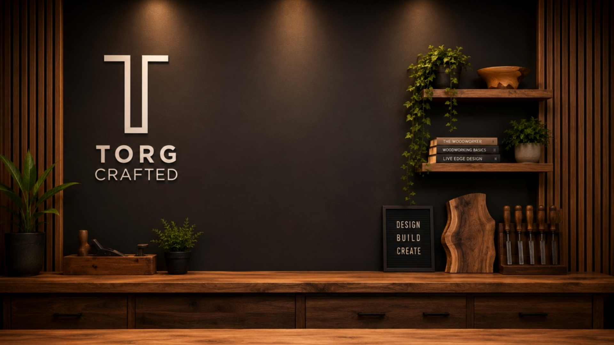

# FireTVLauncher

A minimal, ad-free home screen for Amazon Fire TV. Your own wallpaper, only the apps you choose,
and tiles you can place anywhere on the screen. Built for a woodshop TV that only ever needs
YouTube TV, YouTube, Prime Video and AirPlay.

**Free for anyone to use, copy, change and share** under the [MIT License](LICENSE).
No ads, no tracking, no paid features, no account.


<sub>The included wallpaper. On the TV, app tiles sit in the open area in the middle.</sub>

## Features
- **Any wallpaper.** Full-screen picture of your choice, picked on the TV from the Pictures, Download or DCIM folders.
- **Apps are off by default.** Switch on only the ones you want on the home screen.
- **Place tiles anywhere.** Tiles snap to a fine grid (12, 24 or 48 px) so you can line them up with any wallpaper.
  One column, two columns, staggered, a single row: your choice. Each tile can be resized.
- **Takes over the Home button.** Fire OS always opens Amazon's home screen on Home. An accessibility service
  notices that and switches straight back to this launcher.
- **Opens at power-on.**
- **Tiny.** About 100 KB, plain Java, no Google Play services, no internet access.

## Using it on the TV
| Where | Button | Does |
|---|---|---|
| Home screen | D-pad | Move between tiles (by position on screen) |
| Home screen | Select | Open the app |
| Home screen | ☰ Menu, or hold Select | Launcher menu |
| Menu | Apps | Switch apps on/off |
| Menu | Arrange tiles | Edit layout (grid appears) |
| Arrange | Select | Pick up / drop a tile (yellow outline = moving) |
| Arrange | D-pad | Move one grid cell (hold = fast) |
| Arrange | ⏪ / ⏩ | Make the tile smaller / bigger |
| Arrange | Back or ☰ | Save and leave |
| Menu | Wallpaper | Pick a picture, or a plain dark background |
| Menu | Grid size | 12 / 24 / 48 px snap grid |
| Menu | Amazon home (60 s) | Opens Amazon's home screen and pauses the Home takeover for a minute |
| Menu | Fire TV settings | Opens system settings |

## Built and tested on
| | |
|---|---|
| **TV** | Insignia 55" 4K Fire TV Edition, model **NS-55DF710NA21** (device code AFTDCT31) |
| **Software** | **Fire OS 7.7.1.7** (build PS7717/5746), Android 9 (API 28) |
| **Remote** | Insignia **NS-RCFNA-21** Alexa voice remote |
| **Build machine** | Mac (Apple silicon, macOS), OpenJDK 17 (Homebrew), Android SDK build-tools 34.0.0, platform android-28 |
| **Install method** | Sideloaded over network ADB (no app store) |
| **Date** | November 2026 |

**Tested on that TV and working:**
- Wallpaper display, and switching wallpaper from the menu
- Turning apps on and off (tiles appear and disappear)
- Moving tiles on the snap grid, saving the layout, changing grid size
- Opening YouTube TV, YouTube and Prime Video from their tiles
- Home button returns to the launcher (Amazon's screen flashes for about 2–5 seconds first)
- Launcher opens by itself after a full restart
- Home-button service survives an app update

**Not yet tested:** resizing tiles with ⏪/⏩ on the physical remote.

Other Fire TV models running Fire OS 6–8 (Android 7–11) will probably work but haven't been tried.
Fire TV devices running **Vega OS** (e.g. 2025 Fire TV Stick 4K Select) are **not** Android and won't run it.

## Build
1. Install a JDK 17 and the Android command-line tools:
   ```bash
   brew install openjdk@17
   ```
   Download the Android **command-line tools** from <https://developer.android.com/studio#command-tools>, unzip to
   `~/Library/Android/sdk/cmdline-tools/latest`, then (this asks you to accept Google's Android SDK license):
   ```bash
   JAVA_HOME=/opt/homebrew/opt/openjdk@17 ~/Library/Android/sdk/cmdline-tools/latest/bin/sdkmanager "build-tools;34.0.0" "platforms;android-28"
   ```
   Different locations? Set `JAVA_HOME` and `ANDROID_HOME` before building.
2. Build:
   ```bash
   ./build.sh
   ```
   Produces `out/TorgLauncher.apk`. The first build creates a signing key in `keystore/` (git-ignored).
   **Keep that folder**: updates must be signed with the same key or you'll have to uninstall first.

## Install on a Fire TV
1. On the TV: **Settings → My Fire TV → About**, click the device name 7 times to unlock Developer Options,
   then **Developer Options → ADB Debugging: On**. Note the TV's IP address (**About → Network**).
2. Install ADB on your computer (`brew install --cask android-platform-tools`).
3. Run:
   ```bash
   ./install.sh 192.168.1.50
   ```
   (use your TV's IP). Press **Allow** on the TV the first time. Optional extra arguments: a wallpaper image and a config file:
   `./install.sh <tv-ip> my-wallpaper.jpg my-config.json`.
4. Optional: turn ADB Debugging off afterwards. The launcher keeps working.

`install.sh` installs the app, grants it storage access and the permission it uses to keep its
Home-button service enabled, copies the wallpaper and config over, and turns on the Home-button service.

## Config
The layout lives on the TV at `/sdcard/Android/data/com.torgcrafted.launcher/files/config.json`
and can be edited on the TV (menu) or on your computer and pushed with `install.sh`.
Positions and widths are in pixels on a 1920 × 1080 canvas; tile height is width × 9/16.
```json
{
  "wallpaper": "/sdcard/Pictures/torg-shop-wallpaper.png",
  "grid": 24,
  "tiles": [
    { "pkg": "com.amazon.firetv.youtube.tv",     "x": 672, "y": 312, "w": 264 },
    { "pkg": "com.amazon.firetv.youtube",        "x": 960, "y": 312, "w": 264 },
    { "pkg": "com.amazon.firebat",               "x": 672, "y": 480, "w": 264 },
    { "pkg": "com.apple.airplay.amazon.airplay", "x": 960, "y": 480, "w": 264 }
  ]
}
```
Tip: on Fire TV the real **Prime Video** app is `com.amazon.firebat`. `com.amazon.avod` is "FireTV Player".

## Good to know
- **Amazon updates** can change how the Home button behaves. If an update breaks the takeover, the launcher still
  works and still opens at power-on; only Home goes back to Amazon's screen.
- **Factory reset** removes the launcher like any app. Re-run `install.sh`.
- **Getting to Amazon's screen on purpose:** Menu → *Amazon home (60 s)*.
- **Removing it:** `adb uninstall com.torgcrafted.launcher`. Fire TV goes back to normal.
- The included wallpaper, icon and banner show the Torg Crafted logo. Swap in your own picture with the
  Wallpaper menu, and delete `app/res/drawable/*.png` before building to regenerate the icon from your wallpaper.

See [DESIGN.md](DESIGN.md) for the design notes.

## License
[MIT](LICENSE): free to use, modify and redistribute, including commercially. Provided as-is, without warranty.
